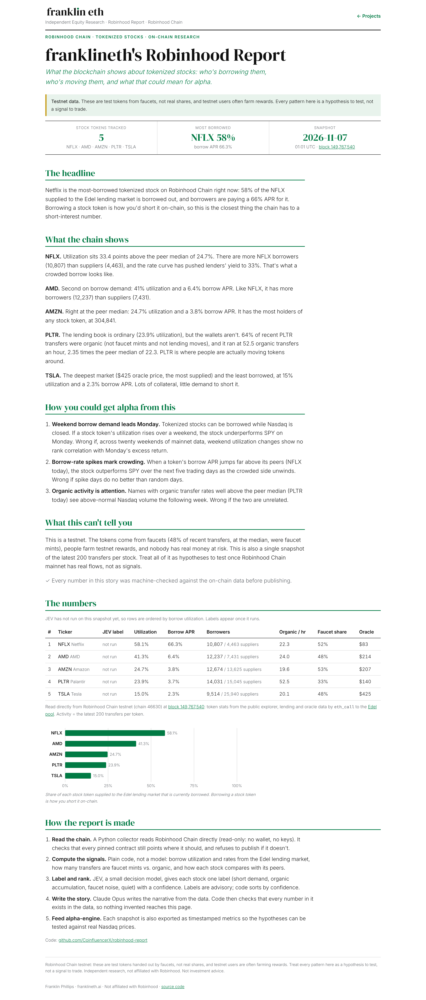
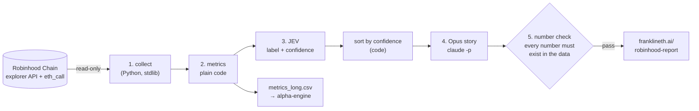

# franklineth's Robinhood Report

**On-chain equity research on tokenized stocks, read straight from Robinhood Chain.**

Tokenized stocks (TSLA, AMZN, PLTR, AMD, NFLX) now live on Robinhood Chain, and there is already a lending market for them (Edel) where people supply stock tokens and others borrow them. Borrowing a stock token is how you short it on-chain, so the chain carries something Wall Street normally pays for: **live borrow demand per stock, around the clock, including weekends when Nasdaq is closed.**

This project turns that into a weekly research report on [franklineth.ai/robinhood-report](https://franklineth.ai/robinhood-report) and a dataset for alpha-engine.



## How it works



| Step | What happens | Who does it | Cost |
|---|---|---|---|
| 1. Collect | Holders and transfers per stock token; Edel supplied/borrowed, utilization, supply/borrow APR, supplier/borrower counts; the protocol's oracle price; the latest 200 transfers split into **faucet mints vs. organic activity**. Pinned contracts are re-verified on-chain every run, and the run refuses to publish if they've changed. | Python, read-only | free |
| 2. Metrics | Peer medians, rank, distance from peers, change since the last snapshot. | Python | free |
| 3. Label | Each stock gets one label: `short_demand`, `organic_accumulation`, `faucet_noise` or `quiet`, with a confidence. Advisory only; code does the sorting. | JEV via Operation Jarvis's budgeted adapter | about 5 tiny calls per report, inside the $1/day ledger |
| 4. Story | A short narrative, plus falsifiable alpha hypotheses with "wrong if…" conditions. | Claude Opus (`claude -p`, subscription) | subscription |
| 5. Check | `rhreport check-story` fails the run if the story contains any number that isn't in the data. | Python | free |

## Is it verifiable?

Yes. Every number comes from public chain data, and the code is open, so anyone can reproduce a report:

```bash
python3 -m rhreport collect          # writes data/snapshots/<time>.json from the live chain
```

Or check a single number by hand with Foundry's `cast` (NFLX utilization = borrowed / supplied):

```bash
RPC=https://rpc.testnet.chain.robinhood.com
cast call 0x54a088624aCc3236966207B43a4e4f22f03cD191 "totalSupply()(uint256)" --rpc-url $RPC   # NFLX borrowed (variableDebtNFLX)
cast call 0xC0D80AEDCA91682CBDd257DdE7D17bCEb766671b "totalSupply()(uint256)" --rpc-url $RPC   # NFLX supplied (eNFLX)
cast call 0xC0D80AEDCA91682CBDd257DdE7D17bCEb766671b "UNDERLYING_ASSET_ADDRESS()(address)" --rpc-url $RPC  # = NFLX token
```

Every snapshot records the block it was read at.

## The first report (2026-11-07, block 149,767,540)

- **NFLX is the most-borrowed stock token:** 58.1% utilization, borrowers paying 66.3% APR, and more borrowers (10,807) than suppliers (4,463).
- **AMD is second** at 41.3%. TSLA is the least borrowed (15.0%) despite being the deepest market.
- **PLTR has the most organic activity:** 52.5 non-faucet transfers an hour, 2.35 times the peer median.
- Faucet mints were 48% of recent transfers at the median. Without that filter, most "activity" would be noise.

Full story: [`data/story.md`](data/story.md). Data: [`data/report.json`](data/report.json), [`data/metrics_long.csv`](data/metrics_long.csv).

## Alpha-engine hook

`data/metrics_long.csv` is in long format (`as_of, ticker, metric, value, source`), with `as_of` being the time the chain was read, so it is point-in-time safe for alpha-engine's `metrics` table. Hypotheses to test once there's enough history (and real mainnet flows):

1. Weekend changes in on-chain borrow utilization predict Monday's excess return vs. SPY.
2. Borrow-rate spikes far above peers mark crowded positioning that mean-reverts over 5 trading days.
3. Organic transfer rates well above the peer median lead above-normal Nasdaq volume the following week.

## Honest limits

- **This is the testnet.** The tokens come from faucets and aren't real shares; users farm testnet rewards; nobody has real money at stake. The pipeline is the point: it's built to point at mainnet flows once they exist.
- One snapshot so far. Trends need many snapshots.
- JEV labels are advisory opinions with a confidence, not facts. A `hold` is shown as a hold.
- Not affiliated with Robinhood. Not investment advice.

## Run it

```bash
python3 -m unittest -v                 # offline tests (all chain data in tests is OFFLINE FIXTURES)
RHREPORT_LIVE=1 python3 -m unittest tests.test_pipeline.Live   # re-verify pinned contracts on the live chain
scripts/run_report.sh                  # full run on the Mac: collect → build → JEV → Opus → check → publish
```

Stdlib-only Python 3.9+. No wallet, no keys, no paid APIs. The RPC client refuses any method that isn't a read.

| | |
|---|---|
| Chain | Robinhood Chain testnet, chain ID 46630 |
| RPC | `https://rpc.testnet.chain.robinhood.com` |
| Explorer | `https://explorer.testnet.chain.robinhood.com` |
| Edel pool | `0x0064394b61942924d63dB20192652CddBCcA745d` |

MIT licensed. Built by [Franklin](https://franklineth.ai).
